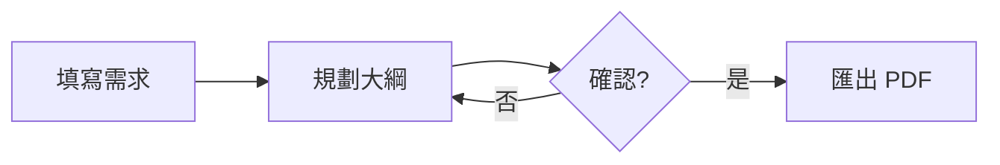

# 簡報視覺增強指南 (visual-guide.md)

本指南指導 Agent 如何結合前端視覺能力與 Slidev 生態系打造世界級質感的簡報。

---

## 1. 原生向量 SVG 繪製守則

- **內嵌 SVG 代碼**：直接在 `slides.md` 內嵌 `<svg viewBox="0 0 800 400">...</svg>`，利用 Tailwind 樣式自適應容器。
- **統一色彩基調**（範本預設；使用者在 `slide.start.json` 的 `notes` 或對話中指定配色時以使用者為準：改 `setup/mermaid.ts` 的 `themeVariables`，頁面底色與文字色寫在 `styles/index.css`（Slidev 自動載入），SVG 與 `<RoughSketch>` 也改用同一組顏色）：
  - 邊框：`#38bdf8`（Sky 400）、`#34d399`（Emerald 400）、`#f59e0b`（Amber 500）。
  - 文字：`#f8fafc`（Slate 50）、`#94a3b8`（Slate 400）。
  - 背景：`#1e293b`（Slate 800 半透明）。
- **箭頭與連接線**：使用 `<defs><marker id="arrow">...</marker></defs>` 保持架構圖與流程圖整潔美觀。
- **SVG 屬性照常寫**：Slidev 的 UnoCSS attributify 原本會把 `font-size="16"`、`stroke="red"` 這類屬性當成樣式（`font-size="16"` 會變成 4rem，大四倍）。範本的 `uno.config.ts` 已經擋掉這些屬性，**不要刪除或改寫這個檔案**；`pnpm run check` 的截圖中 SVG 文字突然變得很大，多半是這個檔案不見了。

---

## 2. Mermaid 圖表（流程圖、時序圖、簡單圖表）

Slidev 內建 Mermaid：在 `slides.md` 寫 ` ```mermaid ` 程式碼區塊，就會畫成 SVG（PDF 中是向量）。節點、連線多的圖用 Mermaid 比手寫 SVG 快，也不用自己算座標；需要精確排版或特殊造型時才手寫 SVG。

````markdown

````

- **常用圖型**：`flowchart`（流程圖、架構圖）、`sequenceDiagram`（時序、API 呼叫）、`stateDiagram-v2`（狀態）、`gantt`（時程）、`timeline`（里程碑）、`mindmap`（心智圖）、`pie`、`xychart-beta`（長條、折線）、`quadrantChart`（四象限）、`sankey-beta`（流量）。
- **大小**：`{scale: 0.8}` 縮放整張圖。橫向的 `flowchart LR` 很寬，放在 `two-cols` 的半欄會蓋到另一欄；橫向圖放整頁寬度，半欄裡用 `flowchart TD` 並控制在 5 個節點左右。`pnpm run check` 只抓超出頁面的內容，**欄位之間互相重疊要看截圖確認**。
- **配色從哪裡來**：範本的 `setup/mermaid.ts` 以 `theme: 'base'` 加上 `themeVariables` 把所有 Mermaid 圖換成 §1 的色系（框線 sky / emerald / amber、淡色底、`#1e293b` 文字、`#64748b` 連線），取代 Mermaid 預設的紫色。預設 Slidev 主題是白底，節點用淡色底配深色字；深色模式（`colorSchema: dark`）會自動換成 `#1e293b` 底、`#f8fafc` 字、`#94a3b8` 連線，不用改設定。不要在每個區塊各自寫 `%%{init: {theme: …}}%%`，整份簡報的圖才會一致；單一節點需要強調時用 `style A stroke:#f59e0b` 或 `classDef`。
- **手繪風格**：`{look: 'handDrawn'}`，搭配下方的 `<RoughSketch>` 可以做出白板風格的簡報（見 [SKILL.md](SKILL.md#outline) 的「整體風格」）。`setup/mermaid.ts` 也固定了手繪線條的種子，檢查截圖、PDF 與網頁版的線條才會一致；其他全域 Mermaid 設定也寫在這個檔案。
- **放在 HTML 容器裡要空行**：` ```mermaid ` 區塊（以及清單、程式碼等任何 Markdown）放進 `<div>` 時，`<div …>` 之後與 `</div>` 之前都要**空一行**，否則 Markdown 不會解析，頁面上會直接印出 `mermaid flowchart …` 原始文字（`pnpm run check` 會回報「Mermaid 區塊被當成文字印出來」；Mermaid 語法錯誤則回報「Mermaid 圖畫不出來」）：
  ````markdown
  <div class="mt-4">

  ```mermaid {look: 'handDrawn'}
  flowchart LR
    A --> B
  ```

  </div>
  ````
- **文字**：節點文字要短（10 個字以內），長說明放在投影片的 HTML 文字裡；中文標點會讓節點變寬。

---

## 3. 手繪風格 `<RoughSketch>`

範本的 `components/RoughSketch.vue` 把一般 SVG 畫成手繪風格（底層是 Rough.js）：照常寫 `rect`、`circle`、`ellipse`、`line`、`polyline`、`polygon`、`path`，組件會換成手繪線條；`text`、`marker` 與其他元素保持原樣。輸出仍是 SVG，PDF 中是向量。

```html
<div class="mx-auto w-80 text-sky-500">
  <RoughSketch viewBox="0 0 360 200">
    <defs>
      <marker id="tip" viewBox="0 0 10 10" refX="6" refY="5" markerWidth="6" markerHeight="6" orient="auto-start-reverse">
        <path d="M 0 1 L 8 5 L 0 9 z" fill="currentColor" />
      </marker>
    </defs>
    <rect x="20" y="65" width="120" height="70" fill="#bae6fd" />
    <text x="80" y="106" font-size="18" text-anchor="middle" fill="currentColor">草稿</text>
    <line x1="145" y1="100" x2="210" y2="100" marker-end="url(#tip)" />
    <circle cx="275" cy="100" r="55" fill="#bbf7d0" data-fill-style="cross-hatch" />
  </RoughSketch>
</div>
```

- **必填 `viewBox`**，寬度由外層容器決定（例如 `w-80`、`w-full`）。
- **線條**：`stroke`（預設 `currentColor`，所以外層的 `text-sky-500` 就是線條色）、`stroke-width`（預設 2）、`stroke-dasharray`；`marker-end` / `marker-start` 會保留，箭頭照常用 `<marker>`。
- **填色**：`fill` 預設畫成斜線（hachure）；單一形狀用 `data-fill-style` 改成 `solid`、`cross-hatch`、`zigzag`、`dots`，整張圖用 `fill-style` 屬性。`data-roughness` 調單一形狀的潦草程度（0 是直線，預設 1.2）。
- **固定的線條**：同樣的內容每次都畫出同樣的線條（`seed` 預設 1）；想換一種抖動就改 `:seed="2"`。
- **`rect` 沒有圓角**（`rx` 會被忽略），手繪風格本來就不需要。
- **逐步出現**：`v-click` 加在 `<RoughSketch>` 或外層元素上，不要加在裡面的 SVG 元素上（組件畫出的是複本，裡面的 `v-click` 不會作用）。要分步驟出現，就拆成幾個 `<RoughSketch>`。
- 文字仍是一般 SVG 文字；需要手寫感時用較圓潤的字型即可，不要把文字畫成線條。

---

## 4. Three.js / WebGL 3D 組件規範

- **自動載入機制**：Slidev 自動將 `components/*.vue` 註冊為全域組件，Agent 無需在 Markdown 中寫 `import`。
- **可重用 3D 組件範例**：
  - `<ThreeGlobe />`：旋轉線框地球，適合展示全球化、雲端運算、網路通訊主題。
- **撰寫新的 3D 組件注意事項**：
  - 必須在 `onBeforeUnmount` 執行 `cancelAnimationFrame` 與 `renderer.dispose()`，避免記憶體洩漏與多頁切換卡頓。
  - 建立 renderer 時設定 `new THREE.WebGLRenderer({ alpha: true, antialias: true, preserveDrawingBuffer: true })`：`alpha` 讓畫布融入主題背景；`preserveDrawingBuffer` 讓匯出 PDF 時畫面不會是空白。
  - WebGL 畫面在 PDF 中是點陣圖（不是向量），只用來營造氛圍；需要讀的文字與數據放在 HTML / SVG 裡。

---

## 5. Clicks 與動畫過渡

- **逐步列點**：用 `<v-clicks>` 包住清單，每按一次出現一項：
  ```markdown
  <v-clicks>

  - 項目一
  - 項目二

  </v-clicks>
  ```
- **單一元素**：在元素上加 `v-click`，例如 `<div v-click>第二步才出現</div>`。
- **指定步驟**：`v-click="2"` 在第 2 次點擊時出現；`v-after` 與前一個元素同時出現。

---

## 6. Remotion 程式化動效與影片整合

[Remotion](https://github.com/remotion-dev/remotion) 是一套以 React 與 Web 技術打造程式化影片與動態視覺的強大框架。

> **授權條款提醒（Remotion License）**：
> Remotion 採用的授權條款（[remotion.dev/license](https://www.remotion.dev/license)）規定：個人、非營利專案，以及編制在 3 人（含）以下的小型團隊可免費使用；若組織編制大於 3 人，商業使用需取得官方商業授權。
> **Agent 的提示義務**：向使用者提議使用 Remotion、安裝套件或執行渲染前，**必須主動以白話向使用者提示此授權條件**，確認使用者了解並同意後再進行製作。

當簡報需要高度客製化的演算法視覺化、精準到影格（frame-level）的時間軸動畫、複雜 UI 互動還原或具科技感的宣傳動態卡片時，可善用 Remotion 製作高品質的動態展示。

### 做法 A：以 Remotion CLI 預渲染為視訊嵌入（最推薦、最穩定）

這是與 Slidev 結合的最佳實踐：由 Agent 編寫 Remotion Composition，渲染為輕量 MP4 / WebM 後直接嵌入投影片。

1. **撰寫 Remotion Composition**：
   使用 React + Remotion 的 `spring`、`interpolate`、`Sequence` 編寫動效。
2. **渲染視訊至 `public/`**：
   ```bash
   npx remotion render src/index.ts <CompositionName> public/remotion/feature-demo.mp4
   ```
3. **在 `slides.md` 嵌入播放**（Slidev 會自動提供 `public/` 下的檔案）：
   ```html
   <div class="rounded-xl overflow-hidden shadow-2xl border border-slate-700/50 max-w-xl mx-auto">
     <video autoplay loop muted playsinline class="w-full">
       <source src="/remotion/feature-demo.mp4" type="video/mp4" />
     </video>
   </div>
   ```

- **優點**：播放流暢零負擔；在執行 `pnpm run check` 與匯出 PDF（`pnpm run export`）時 Playwright 能夠穩定捕捉畫面。
- **PDF 匯出提醒**：匯出 PDF 時視訊會呈現為靜態影格，投影片的關鍵數據或結論仍建議放在 Markdown / HTML 文字中。

### 做法 B：在自訂 Vue 組件中運用 Remotion 動效運算

若要在投影片中製作由使用者點擊或事件驅動的即時動效，可安裝 `remotion`（`pnpm add remotion`），在 `components/*.vue` 中直接引入其核心數學運算函數（如 `spring`、`interpolate`、`interpolateColors`）：
- 純函數計算，無額外執行時副作用，能精確計算出具彈性（spring physics）的平滑補間值，驅動 SVG 或 HTML 元素的縮放與移動。

---

## 7. 生圖需求與 AI Prompt 提供（單張插圖與 Spritesheet）

當投影片需要概念配圖、視覺意象、科技氛圍背景、或逐步變化的微動畫序列，而既有向量庫或素材無法滿足時：

- **主動提議提供 Prompt**：特別是在製作動態視覺或步驟圖解時，**若元素透過 Spritesheet 取得高品質圖示能大幅提升整體動畫質感**，Agent 應主動向使用者確認：「這頁的動態元素如果使用 Spritesheet 能呈現更細膩高級的質感，是否需要我為你撰寫生圖用的 Prompt，讓你拿去給生圖 AI（如 Midjourney、DALL-E、Flux 等）生成圖片？」
- **單張整張圖（Single Image）**：
  - 適合封面意象、滿版背景底圖、重要概念示意插圖。
  - 圖片產生後放置於 `public/images/`，在 `slides.md` 直接引用：``。
- **精靈圖序列（Spritesheet）**：
  - 適合步進式圖解、連環動作分解、微表情或逐幀視覺變化。
  - Agent 撰寫 Prompt 時指定等距網格連續幀（例如：`flat 2D vector sequence, 6 steps animation sprite sheet of data transformation, transparent background`）。
  - 在 Slidev 頁面中，可搭配 `<div class="steps-animation">` 以 CSS `animation: play steps(6) infinite` 或結合 `v-click` 逐格展示變換效果。
- **直接使用 CC0 免費素材庫**：
  若需要快速獲取高品質素材，亦可直接從 CC0（公有領域 / 免授權）素材庫抓取檔案存入 `public/` 使用：
  - **向量圖形與圖示**：[SVG Repo](https://www.svgrepo.com/)（可篩選 CC0 License）、[Openclipart](https://openclipart.org/)（CC0 向量庫）。
  - **2D 精靈圖、UI 與動畫素材**：[Kenney.nl](https://kenney.nl/)（全站完全 CC0，含大量圖示、精靈圖 spritesheet 與 UI）。
  - **高解析度照片與情境背景**：[Unsplash](https://unsplash.com/)、[Pexels](https://www.pexels.com/)、[Pixabay](https://pixabay.com/)。
